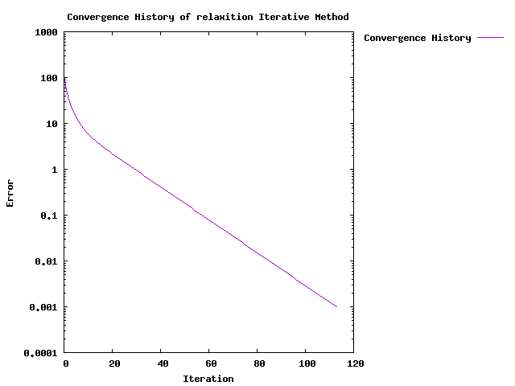
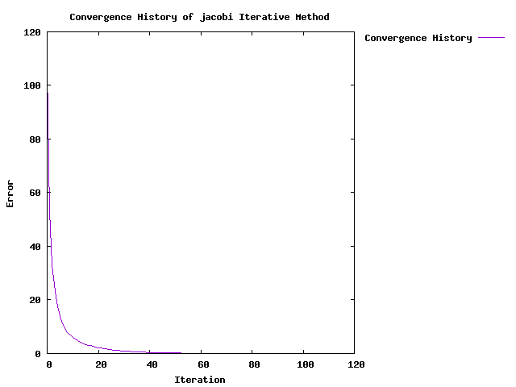
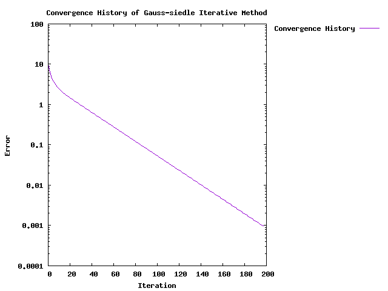

# 1D Poisson Solver — Direct and Iterative Methods with BLAS/LAPACK

Numerical solution of the stationary 1D heat equation `-k T'' = 0` on `[0, 1]` with Dirichlet boundary conditions, discretised with second-order centred finite differences. The resulting tridiagonal system `Au = f` is solved in C with **direct** (LU) and **iterative** methods, using BLAS and LAPACK on band-stored matrices.

Numerical Computing lab (*Calcul Numérique*, TD/TP 5), M1 CHPS, Université Paris-Saclay, 2023–2024. Report (French): [`raport.pdf`](raport.pdf).

## Methods implemented

**Direct**
- LAPACK `dgbtrf` / `dgbtrs` (band LU factorisation and solve) and the `dgbsv` driver
- `dgbtrftridiag`: a hand-written LU factorisation specialised for tridiagonal matrices, compatible with the LAPACK band format

**Iterative** (residual history saved for each run)
- Richardson with fixed `α` and with optimal `α_opt` computed from the extreme eigenvalues
- Jacobi
- Gauss-Seidel

The matrix is stored in **general band (GB) column-major format**, so `cblas_dgbmv` performs the matrix-vector products; residual norms use `cblas_dnrm2`.

## Convergence

| Richardson (α) | Jacobi | Gauss-Seidel |
|---|---|---|
|  |  |  |

Residual histories (`RESVEC.dat`) and gnuplot scripts are in [`graphes/`](graphes/).

## Build and run

The code lives in `TP_Poisson_C_students_2022_part2/` (direct and iterative) and `TP_Poisson_C/` (direct only). Each needs BLAS, LAPACK and LAPACKE.

```bash
cd TP_Poisson_C_students_2022_part2
cp new.mk $(hostname).mk      # the Makefile includes <hostname>.mk for compiler/library paths
make all
make run_tpPoisson1D_direct
make run_tpPoisson1D_iter
```

Or in a container, with all dependencies installed:

```bash
docker build -t poisson1d .
docker run -it poisson1d          # then: make all && make run_tpPoisson1D_iter
```

## Author

**Ahmed Taleb Bechir**
[atbechir.com](https://atbechir.com) · [LinkedIn](https://www.linkedin.com/in/ahmed-taleb-bechir-97a7301a4) · [GitHub](https://github.com/talebbechir123)

Lab framework: T. Dufaud, J. Gurhem.
